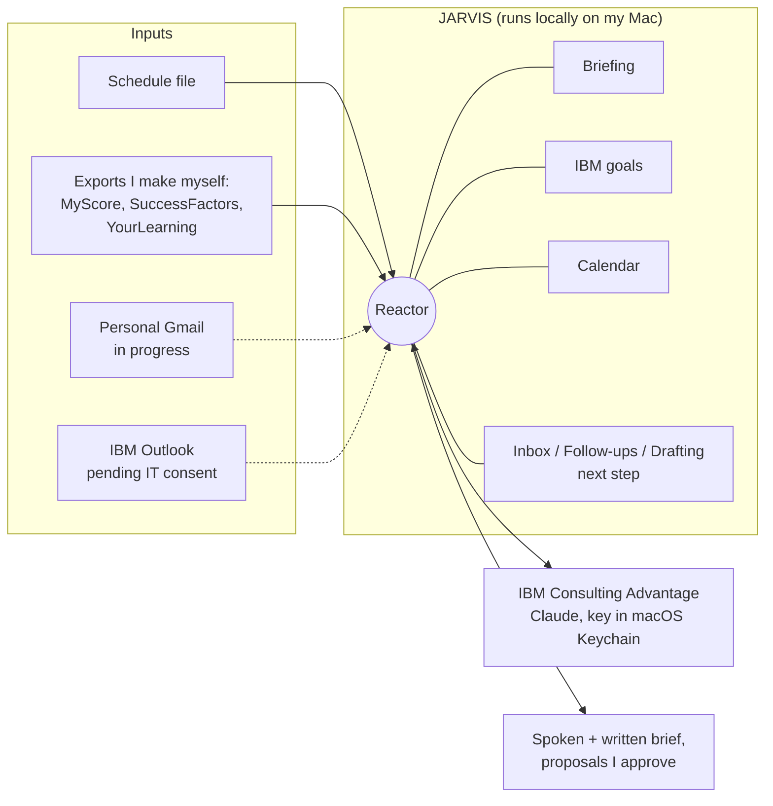
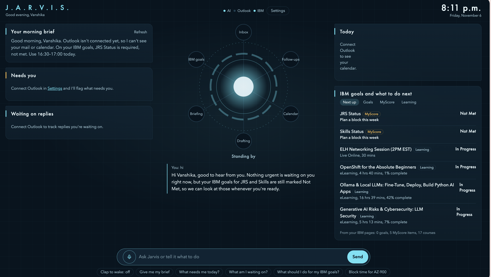
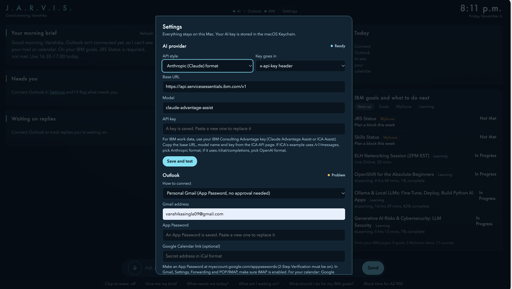
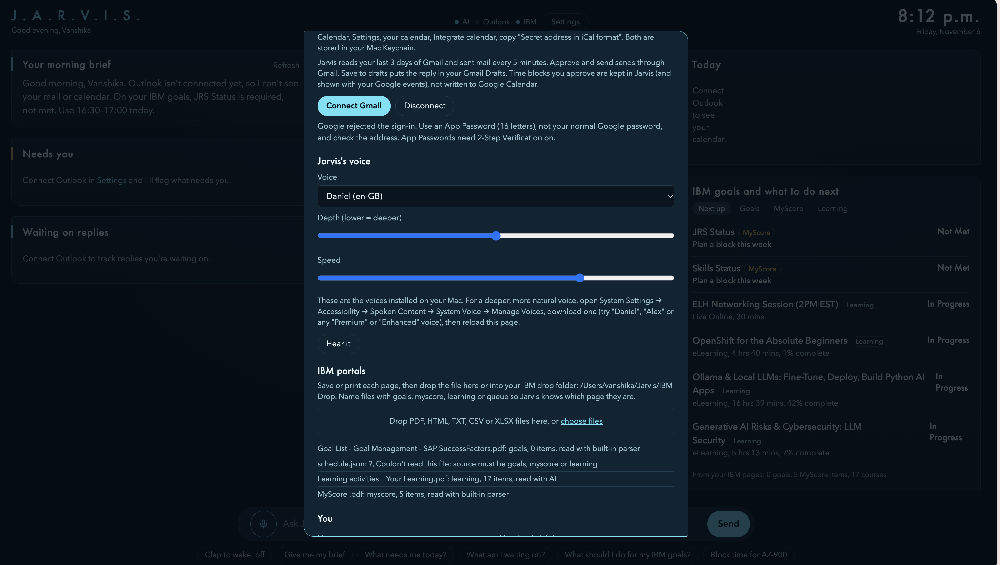
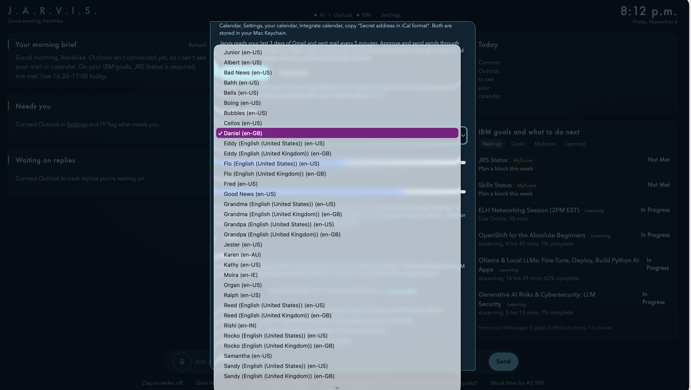
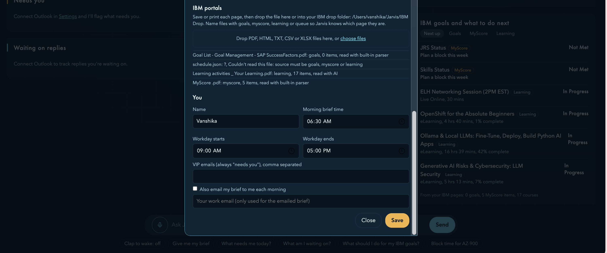
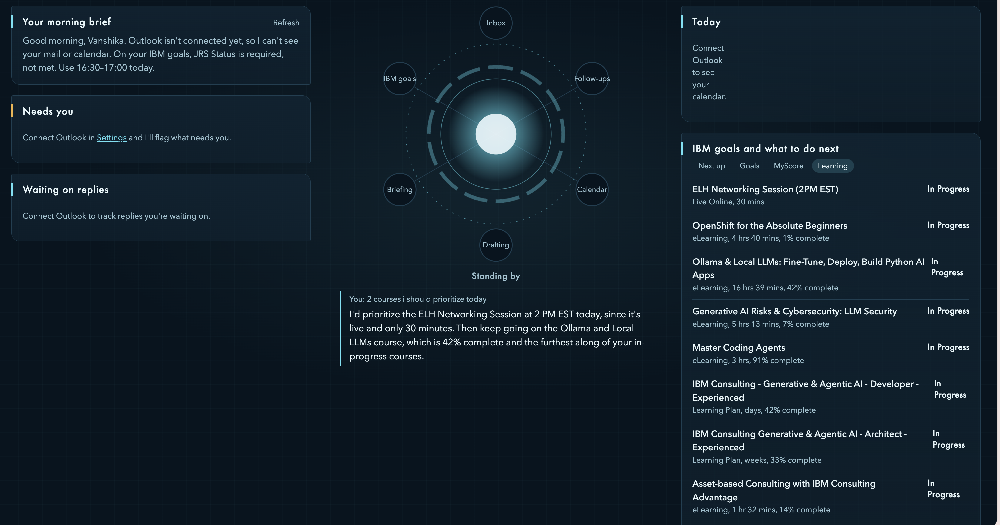

# J.A.R.V.I.S: demo, screenshots and badge material

A proactive personal AI work assistant: several agents behind one dashboard, coordinated by a central reactor. It brings my IBM work data (MyScore credentials, SuccessFactors goals, YourLearning courses) together with my calendar and email into a spoken and written morning brief. It runs locally, and the model calls go through IBM Consulting Advantage (Claude).

## What is in this folder

| Item | What it is |
|---|---|
| [`JARVIS_architecture.pdf`](JARVIS_architecture.pdf) | 6-slide architecture deck (editable: [`.pptx`](JARVIS_architecture.pptx)) |
| [`JARVIS_written_application.md`](JARVIS_written_application.md) | Project write-up: problem, use cases, approach, risks |
| [`screenshots/`](screenshots/) | Six screenshots of the running app (shown below) |
| Source code | In the repo root: [`jarvis/`](../../jarvis) (app), [`web/`](../../web) (dashboard), [`extension/`](../../extension) (not installed) |

## Architecture at a glance

Nothing is sent or changed without my approval. The full deck is in [`JARVIS_architecture.pdf`](JARVIS_architecture.pdf).

## Screenshots

### 1. Morning brief
`screenshots/1-morning-brief.png`

The dashboard with the reactor and agent nodes (Inbox, IBM goals, Follow-ups, Briefing, Calendar, Drafting). The brief points to the IBM goals that need attention, and the right-hand panel lists MyScore items and learning courses.

### 2. API key and mail connection
`screenshots/2-api-and-mail-settings.png`

The AI provider (Anthropic-format API through IBM Consulting Advantage, model `claude-advantage-assist`) shows "Ready". The key is stored in the macOS Keychain. The mail section shows the connection options.

### 3. Voice features and document import
`screenshots/3-voice-and-import.png`, `screenshots/3-voice-options.png`

Voice, depth and speed settings, plus the list of voices installed on the Mac. The import list shows the MyScore export (5 items) and the YourLearning export (17 items) read successfully.

### 4. Documents and morning-brief settings
`screenshots/4-documents-and-brief-settings.png`

The IBM drop-folder import and the personal settings: name, brief time, workday hours, VIP emails, and the option to email the brief each morning.

### 5. Productivity with JARVIS
`screenshots/5-learning-recommendation.png`

The Learning tab and a chat answer to "2 courses I should prioritise today".

## Status

- **Working:** dashboard and agent nodes, spoken and written morning brief, AI chat through IBM Consulting Advantage, voice settings, import of MyScore and YourLearning exports, learning recommendations.
- **In progress:** SuccessFactors goal import (the PDF is read but no goals are extracted yet) and personal Gmail (sign-in is rejected in the current setup).
- **Not connected:** IBM Outlook, which needs IT admin consent. The browser extension in `extension/` is written but not installed or used, until IBM confirms it is allowed.

## Data and privacy

The screenshots come from a local run on my own Mac, using exports I made myself. JARVIS does not sign in to or scrape any IBM portal.
